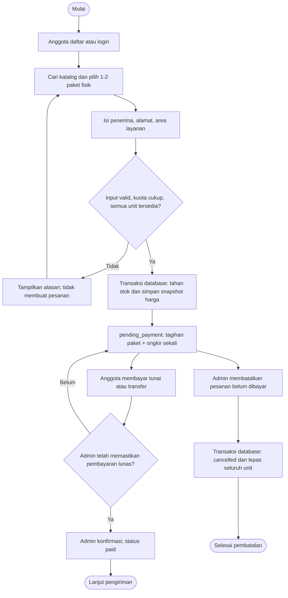
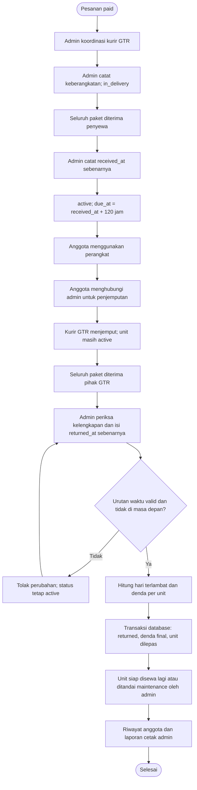

# Flowchart GT-Rent

Versi 1.0 | 22 Oktober 2026 | Target tugas: besok, 23 Oktober 2026.

Diagram ini mengikuti BRD dan PRD versi 1.0. Satu paket PC + monitor dihitung satu unit. Satu paket peripheral tetap juga satu unit. Fullset menggabungkan keduanya menjadi dua unit. Kuota berlaku untuk seluruh pesanan anggota.

## 1. Pemesanan dan pembayaran

- Pemeriksaan kuota, pemeriksaan ketersediaan, dan penyimpanan pesanan harus satu operasi atomik.
- Stok ditahan pada status `pending_payment`, `paid`, `in_delivery`, dan `active`.
- Anggota yang sudah menahan dua unit tidak dapat membuat pesanan tambahan meskipun belum membayar.
- Pilihan fullset memasukkan dua kode unit yang berbeda ke satu pesanan, tanpa membuat stok ketiga.
- Ongkir demo Rp75.000 per pesanan mencakup antar-jemput dalam area demo Bandung, Bojongsoang, dan Dayeuhkolot. Tarif ini asumsi akademik.

## 2. Pengiriman, penggunaan, dan pengembalian

Jika GTR menerima perangkat tepat pada jatuh tempo, denda nol. Keterlambatan positif sampai 24 jam dihitung satu hari. Keterlambatan lebih dari 24 sampai 48 jam dihitung dua hari. Sistem menyimpan waktu pencatatan admin terpisah dari waktu kejadian.

## 3. Status transaksi

```mermaid
stateDiagram-v2
    [*] --> pending_payment: Checkout valid; unit ditahan
    pending_payment --> paid: Admin konfirmasi lunas
    pending_payment --> cancelled: Admin batalkan
    paid --> in_delivery: Admin catat pengiriman
    in_delivery --> active: Admin catat penerimaan penyewa
    active --> returned: Admin catat penerimaan GTR
    cancelled --> [*]
    returned --> [*]
```

Label `overdue` muncul ketika status `active` dan waktu sekarang melewati `due_at`. Sistem tidak menyimpannya sebagai status tersendiri atau mengembalikan unit secara otomatis. Admin mencatat semua perubahan status setelah anggota membuat pesanan.

Pembatalan otomatis, pengembalian sebagian, perubahan isi paket, penambahan unit setelah checkout, dan pembatalan setelah lunas tidak termasuk alur versi pertama. Kasus komersial di luar alur ditangani manual dan tidak boleh diakali dengan mengubah status langsung.

## 4. Aktor dan kontrol

| Aksi | Anggota | Admin | Kurir |
|---|---|---|---|
| Daftar, login, ubah profil sendiri | Ya | Login dan profil sendiri | Tidak ada akun |
| Cari katalog, pesan untuk diri sendiri | Ya | Dapat membaca katalog, tanpa menyewa sebagai admin | Melalui koordinasi admin |
| Konfirmasi pembayaran/pengiriman/penerimaan | Tidak | Ya | Memberi kabar kepada admin |
| Membatalkan pesanan belum lunas | Menghubungi admin | Ya | Tidak |
| Mencatat pengembalian dan denda | Tidak | Ya | Menyerahkan barang ke GTR |
| Riwayat/cetak | Riwayat sendiri | Semua riwayat dan cetak | Tidak |

Sumber visual siap dibagikan: `../output/pdf/GT-Rent-Flowchart.pdf`. Diagram gambar dan sumber Mermaid tersedia di folder `diagrams/`.
