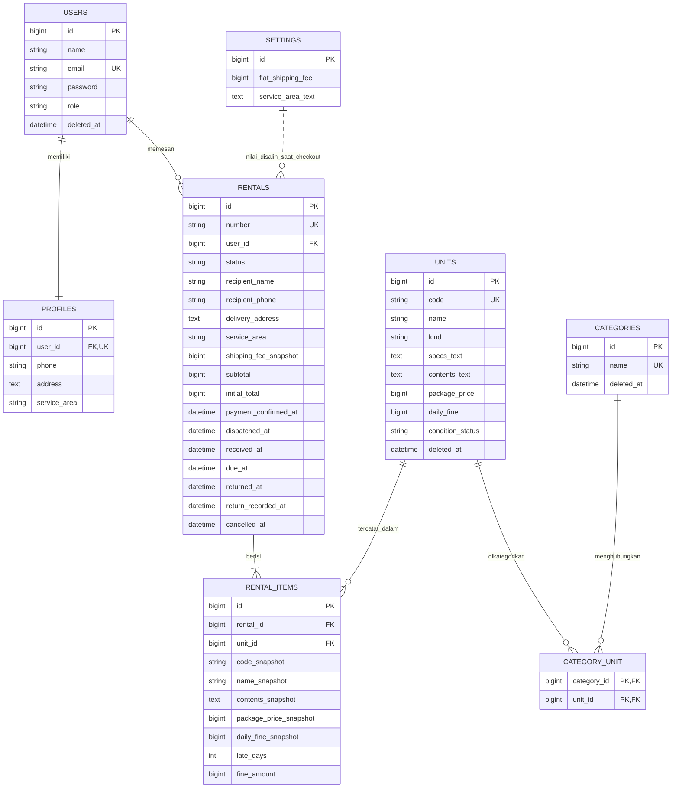

# ERD awal GT-Rent

Versi 1.0 | 22 Oktober 2026 | Delapan tabel bisnis inti. Tabel bawaan framework seperti sessions, cache, jobs, dan password_reset_tokens tidak ditampilkan pada ERD bisnis.

## 1. Relasi utama

Garis putus-putus dari `settings` ke `rentals` adalah aliran salinan nilai, **bukan foreign key**. Ongkir lama tidak berubah ketika pengaturan ongkir diperbarui. Diagram PDF/SVG membedakan koneksi ini dari relasi foreign key.

## 2. Kamus data dan batasan

Semua tabel selain pivot memiliki `created_at` dan `updated_at`. Seluruh uang disimpan sebagai bilangan bulat rupiah, tanpa pecahan floating point. Waktu kejadian disimpan sebagai UTC dan ditampilkan sebagai WIB. `?` berarti nullable.

### users

| Kolom | Jenis logis | Aturan |
|---|---|---|
| id | bigint | Primary key |
| name | varchar(100) | Wajib |
| email | varchar(254) | Wajib, unique termasuk akun diarsipkan |
| password | varchar(255) | Hash password, tidak ditampilkan |
| role | varchar(10) | Hanya admin/member. Register publik selalu member |
| deleted_at | datetime? | Penanda arsip akun. Sistem menolak login akun yang diarsipkan |

Registrasi dan pembuatan akun oleh admin membuat satu profil dalam transaksi yang sama. Admin tidak dapat mengarsipkan akun sendiri atau anggota yang masih memiliki unit ditahan. Akun historis diarsipkan, bukan dihapus beserta transaksi.

### profiles

| Kolom | Jenis logis | Aturan |
|---|---|---|
| id | bigint | Primary key |
| user_id | bigint | FK users.id dan UNIQUE untuk satu profil per pengguna |
| phone | varchar(20)? | Diisi saat melengkapi profil. Nomor penerima wajib saat checkout |
| address | text? | Alamat default. Checkout menyimpan salinan terpisah |
| service_area | varchar(30)? | Bandung/Bojongsoang/Dayeuhkolot |

UNIQUE hanya menjamin maksimal satu profil. Keberadaan tepat satu profil dijaga oleh proses pembuatan akun atomik dan pengujian, bukan oleh foreign key saja.

### categories dan category_unit

| Tabel/kolom | Jenis logis | Aturan |
|---|---|---|
| categories.id | bigint | Primary key |
| categories.name | varchar(80) | Wajib dan unique |
| categories.deleted_at | datetime? | Penanda arsip kategori. Transaksi lama tetap terbaca |
| category_unit.category_id | bigint | FK categories.id |
| category_unit.unit_id | bigint | FK units.id |
| Pasangan pivot | composite PK/UNIQUE | Satu kategori tidak dipasang dua kali pada unit sama |

### units

| Kolom | Jenis logis | Aturan |
|---|---|---|
| id | bigint | Primary key |
| code | varchar(30) | Wajib, unique sepanjang inventaris termasuk arsip |
| name | varchar(120) | Wajib. Nama boleh sama antar set fisik |
| kind | varchar(20) | pc_monitor/peripheral |
| specs_text | text | Deskripsi spesifikasi yang ditampilkan |
| contents_text | text | Daftar isi tetap, satu baris per komponen/kelengkapan |
| package_price | bigint | Harga paket maksimal lima hari, integer >= 0 |
| daily_fine | bigint | Denda keterlambatan per hari untuk unit ini, integer >= 0 |
| condition_status | varchar(20) | ready/maintenance |
| deleted_at | datetime? | Penanda arsip. Unit tidak muncul untuk pemesanan baru |

Rancangan tidak memakai tabel stok komponen atau parent-child rekursif. Komponen mengikuti paket dan tidak disewakan terpisah. Admin mengalokasikan set fisik yang berbeda ke tiap kode unit. Selama unit masih ditahan, admin tidak boleh mengubah jenis, kelengkapan, atau perangkatnya. Admin juga harus menyelesaikan pengembalian sebelum mengarsipkan unit atau menandainya maintenance melalui CRUD biasa.

Ketersediaan diturunkan dari `condition_status=ready`, `deleted_at` kosong, dan tidak adanya `rental_items` untuk unit tersebut pada rental berstatus penahan stok. Jangan menyimpan status available/reserved kedua yang mudah tidak sinkron.

### rentals

| Kolom | Jenis logis | Aturan |
|---|---|---|
| id, number | bigint, varchar(30) | Primary key dan nomor transaksi unique |
| user_id | bigint | FK users.id untuk anggota pemesan |
| status | varchar(20) | pending_payment/paid/in_delivery/active/returned/cancelled |
| recipient_name, recipient_phone | varchar(100), varchar(20) | Wajib. Salinan data saat checkout |
| delivery_address, service_area | text, varchar(30) | Wajib. Salinan alamat dan area layanan |
| shipping_fee_snapshot | bigint | Ongkir antar-jemput saat checkout, sekali per pesanan |
| subtotal, initial_total | bigint | subtotal = jumlah harga item. initial_total = subtotal + ongkir |
| payment_method | varchar(10)? | cash/transfer. Wajib saat admin mengonfirmasi pelunasan |
| payment_confirmed_by | bigint? | FK users.id. Wajib setelah admin mengonfirmasi pembayaran |
| payment_confirmed_at | datetime? | Waktu pencatatan konfirmasi pembayaran |
| dispatched_at | datetime? | Waktu keberangkatan sebenarnya, setelah pembayaran |
| dispatched_by | bigint? | FK users.id untuk admin pencatat pengiriman |
| received_at | datetime? | Waktu seluruh unit diterima penyewa |
| receipt_recorded_at | datetime? | Waktu admin memasukkan received_at |
| receipt_recorded_by | bigint? | FK users.id untuk admin pencatat penerimaan penyewa |
| due_at | datetime? | Sistem menghitung received_at + 120 jam |
| returned_at | datetime? | Waktu seluruh unit benar-benar diterima GTR |
| return_recorded_at | datetime? | Waktu admin memasukkan pengembalian |
| returned_by | bigint? | FK users.id untuk admin pencatat pengembalian |
| return_notes | text? | Catatan pemeriksaan/kelengkapan |
| cancelled_at, cancelled_by | datetime?, bigint? | FK actor ke users.id. Hanya untuk pending_payment |
| cancel_reason | varchar(255)? | Wajib saat pembatalan |

`payment_confirmed_by`, `dispatched_by`, `receipt_recorded_by`, `returned_by`, dan `cancelled_by` adalah relasi admin ke users. Diagram visual merangkum relasi ini agar garis tidak bertumpuk. Aplikasi memeriksa role admin karena foreign key tidak memeriksa role.

Transaksi tidak memiliki `settings_id`. Total denda cukup dihitung dari jumlah `rental_items.fine_amount`, tanpa salinan wajib di header. Sistem menghitung estimasi denda saat transaksi aktif dibaca dan menyimpan denda final saat pengembalian.

### rental_items

| Kolom | Jenis logis | Aturan |
|---|---|---|
| id | bigint | Primary key |
| rental_id | bigint | FK rentals.id. Satu transaksi memiliki 1-2 baris |
| unit_id | bigint | FK units.id. Satu set fisik per baris, tanpa quantity > 1 |
| code_snapshot, name_snapshot | varchar(30), varchar(120) | Identitas ketika checkout |
| contents_snapshot | text | Kelengkapan ketika checkout |
| package_price_snapshot | bigint | Harga lima hari ketika checkout |
| daily_fine_snapshot | bigint | Tarif denda ketika checkout |
| late_days | integer | Default 0. Nilai final pada returned |
| fine_amount | bigint | Default 0. late_days x daily_fine_snapshot |
| rental_id + unit_id | UNIQUE | Unit sama tidak muncul dua kali dalam satu pesanan |

Unit boleh muncul lagi pada pesanan lain setelah dikembalikan. Karena itu, jangan membuat `unit_id` unique secara global pada tabel riwayat. Aturan satu peminjam aktif dijaga transaksi database dan penguncian baris unit.

### settings

| Kolom | Jenis logis | Aturan |
|---|---|---|
| id | bigint | Satu baris konfigurasi, id=1 |
| flat_shipping_fee | bigint | Ongkir antar-jemput dengan default demo 75000 |
| service_area_text | text | Keterangan area Bandung dan sekitar Telkom: Bojongsoang/Dayeuhkolot |

Pilihan area valid pada MVP adalah Bandung, Bojongsoang, dan Dayeuhkolot. Area ini merupakan batas layanan simulasi tanpa geocoding. Admin memeriksa alamat aktual sebelum mengonfirmasi pembayaran. Pengaturan teks tidak memetakan batas geografis secara otomatis.

## 3. Indeks, constraint, dan riwayat

- UNIQUE: users.email, profiles.user_id, categories.name, units.code, rentals.number, pivot(category_id, unit_id), rental_items(rental_id, unit_id).
- Indeks pencarian dan relasi meliputi units.name, rentals(user_id, status), rental_items(unit_id, rental_id), dan seluruh FK actor.
- FK ke users/units/rentals memakai RESTRICT untuk penghapusan fisik data historis. Pengarsipan tidak menghapus transaksi.
- Rekaman transaksi tidak memiliki tombol hapus. Pembatalan adalah perubahan status dengan alasan dan actor.
- Aplikasi menjaga batas 1-2 item per pesanan dan maksimal dua unit ditahan lintas pesanan melalui transaksi database. UNIQUE biasa tidak cukup untuk aturan ini.
- Snapshot harga, denda, ongkir, nama unit, isi, dan alamat menghindari perubahan riwayat ketika master data diperbarui.

## 4. Pencegahan benturan stok dan kuota

Baseline database implementasi: MySQL 8 dengan InnoDB. Semua proses yang mengubah penahanan stok menggunakan urutan kunci konsisten: baris anggota, lalu baris unit terurut berdasarkan id, lalu transaksi terkait. Checkout menghitung ulang kuota dan mengecek ketersediaan setelah kunci diperoleh. Jika gagal, seluruh penulisan dibatalkan. Pembatalan dan pengembalian menggunakan transaksi atomik juga.

SQLite dapat dipakai untuk uji domain atau demonstrasi awal. Tim tetap harus menguji pemesanan bersamaan pada database target karena perilaku row lock SQLite dan MySQL tidak identik. Tim belum memeriksa ketersediaan server database dalam pekerjaan dokumentasi ini.

Rujukan teknis: [Laravel database transactions](https://laravel.com/docs/13.x/database), [Laravel pessimistic locking](https://laravel.com/docs/13.x/queries#pessimistic-locking), [Laravel relationships](https://laravel.com/docs/13.x/eloquent-relationships).

Diagram gambar: `diagrams/erd-awal.svg` dan `diagrams/erd-awal.png`. PDF: `../output/pdf/GT-Rent-ERD-Awal.pdf`. Diagram menampilkan kolom inti. Gunakan kamus data di atas sebagai referensi kolom lengkap.
